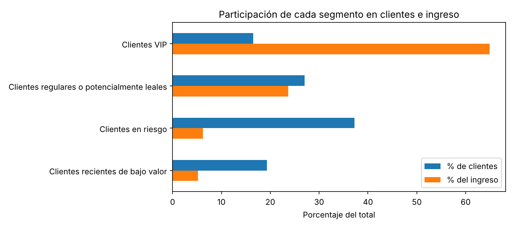

# Segmentación de clientes con RFM y K-Means

> **English summary.** Customer segmentation of a UK online retailer (UCI Online Retail dataset, 541,909 transaction lines, Dec 2010 – Dec 2011). Transactions are aggregated into Recency, Frequency and Monetary features for 4,338 customers and clustered with K-Means. The key finding: 16.5 % of customers generate 64.9 % of revenue. Four segments are kept for interpretability (silhouette 0.337, against 0.433 for k = 2) and they are stable across seeds and subsamples (mean adjusted Rand index 0.97 and 0.95).

Agrupa a los clientes de una tienda online según cuándo compraron por última vez, con qué frecuencia y cuánto gastan, para decidir en quién enfocar las acciones de marketing.

## Resultado principal

**El 16,5 % de los clientes genera el 64,9 % del ingreso.** En el otro extremo, el segmento más numeroso (37,2 % de los clientes) aporta el 6,2 %.



| Segmento | Clientes | % de clientes | % del ingreso | Recencia mediana (días) | Frecuencia mediana (facturas) | Acción propuesta |
|---|---|---|---|---|---|---|
| Clientes VIP | 716 | 16,5 | 64,9 | 8 | 10 | Retención prioritaria, sin descuentos generales |
| Regulares o potencialmente leales | 1.173 | 27,0 | 23,7 | 56 | 4 | Aumentar la frecuencia de compra |
| Recientes de bajo valor | 837 | 19,3 | 5,2 | 17 | 2 | Conseguir la segunda y tercera compra |
| En riesgo | 1.612 | 37,2 | 6,2 | 177 | 1 | Reactivación de bajo costo |

- **Elección de k.** Silhouette: 0,4329 (k = 2), 0,3365 (k = 3), 0,3371 (k = 4), 0,3161 (k = 5). Se elige k = 4 por interpretabilidad: k = 2 separa mejor, pero es demasiado grueso para definir acciones distintas.
- **Estabilidad.** Al repetir K-Means con 20 semillas, la partición con k = 4 coincide con la de referencia con un índice de Rand ajustado medio de 0,971 (mínimo 0,942). Sobre 20 submuestras del 80 % de los clientes, la media es 0,950 (mínimo 0,819). Con k = 5 cae a 0,878.

## Dataset

- **Fuente:** Chen, D. (2015). *Online Retail* [Dataset]. UCI Machine Learning Repository. https://doi.org/10.24432/C5BW33 (licencia CC BY 4.0).
- **Tamaño:** 541.909 líneas de factura y 8 columnas, de diciembre de 2010 a diciembre de 2011; unos 46 MB en CSV. Tras la limpieza quedan 397.884 líneas de 4.338 clientes.
- No se versiona: `scripts/download_data.py` lo descarga de UCI y lo convierte a CSV.

## Cómo reproducirlo

```bash
pip install -r requirements.txt
python scripts/download_data.py
jupyter nbconvert --to notebook --execute --inplace notebooks/customer_segmentation_kmeans.ipynb
```

Probado con Python 3.13. El notebook tarda unos minutos por la prueba de estabilidad.

## Estructura

```
data/
  raw/          dataset descargado (no versionado)
  processed/    salidas del notebook (no versionadas)
figures/
  segmentos_clientes_ingreso.png
notebooks/
  customer_segmentation_kmeans.ipynb
scripts/
  download_data.py
requirements.txt
```

## Limitaciones y próximos pasos

- Un silhouette de 0,34 indica separación moderada: los segmentos son reproducibles, pero sus fronteras son difusas.
- Las acciones propuestas son hipótesis a partir del perfil RFM. El dataset no trae campañas ni costos, así que su efecto no se puede medir aquí; habría que probarlas con un grupo de control.
- Se excluye el 24,9 % de las líneas por no tener identificador de cliente.
- El periodo cubre un solo año, por lo que no se distingue estacionalidad de abandono.
- Próximo paso: comparar con una segmentación por reglas RFM (quintiles) para ver si K-Means aporta algo sobre el método más simple.

## Stack

Python, pandas, scikit-learn y matplotlib.
